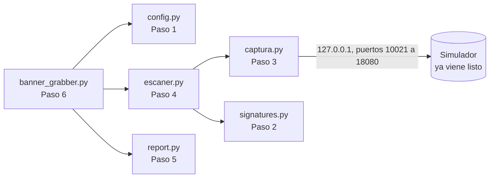

<!-- Idioma del documento: es-CO (español de Colombia) -->
# Guía paso a paso: construya su herramienta de banner grabbing

En esta carpeta usted **construye la herramienta archivo por archivo**. En cada paso crea un archivo, pega el código que le da la guía, lo ejecuta y comprueba el resultado. El código viene **comentado línea a línea para quien ve Python y este tema por primera vez**: cada elemento del lenguaje se explica la primera vez que aparece. Leer esos comentarios es la parte más importante del laboratorio.

Siglas que va a encontrar: TCP (Transmission Control Protocol, protocolo de control de transmisión), HTTP (Hypertext Transfer Protocol, protocolo de transferencia de hipertexto), FTP (File Transfer Protocol, transferencia de archivos), SSH (Secure Shell, consola remota cifrada), SMTP (Simple Mail Transfer Protocol, envío de correo), JSON (JavaScript Object Notation, formato de texto para datos estructurados), TLS (Transport Layer Security, seguridad de la capa de transporte), CVE (Common Vulnerabilities and Exposures, identificador público de una vulnerabilidad) e IP (Internet Protocol, dirección del equipo en la red).

## Antes de empezar

### Qué ya viene en esta carpeta y qué crea usted

| Ya viene listo (no lo modifique) | Para qué sirve |
|---|---|
| `simulador_metasploitable.py`, `servicios_simulados.py` | Hacen de "máquina víctima": publican en `127.0.0.1` los banners de Metasploitable 2. |
| `pasos/` | Un script de comprobación por paso. |
| `validar.py` | Validación final del reporte (Paso 7). |
| `test_firmas.py`, `test_captura_local.py`, `test_seguridad.py` | 26 pruebas automáticas que revisan su código. |
| `ejecutar_laboratorio.sh`, `limpiar.sh` | Comprobación final completa y limpieza. |

| Lo crea usted (pegando el código de la guía) | Paso |
|---|---|
| `config.py` | 1 |
| `signatures.py` | 2 |
| `captura.py` | 3 |
| `escaner.py` | 4 |
| `report.py` | 5 |
| `banner_grabber.py` | 6 |

### Cómo trabajar cada paso

1. **Lea el concepto** del paso: explica qué va a construir y por qué.
2. **Cree el archivo** con su editor, dentro de esta carpeta. Por ejemplo, `code config.py` (VS Code) o `nano config.py`.
3. **Copie el bloque de código completo** de la guía y péguelo en el archivo. En GitHub, cada bloque tiene un botón de copiar en la esquina superior derecha.
4. **Guarde** el archivo.
5. **Ejecute la comprobación** del paso y compare su salida con la salida esperada.
6. **Lea los comentarios del código** (las líneas que empiezan por `#` y los textos entre `"""`). Explican cada parte. Luego lea la sección "Fíjese en" del paso.

Si algo no funciona, lo más común es que el código se haya pegado incompleto o con la sangría cambiada. Compare su archivo con la respuesta: `diff config.py ../solucion/config.py` (si no muestra nada, son idénticos).

### Cómo se ve el laboratorio



No hay máquinas virtuales: el simulador escucha solo en `127.0.0.1`, de modo que ningún paquete sale de su equipo. Cada servicio queda en su puerto estándar más 10 000 (FTP, que usa el 21, pasa a 10021; MySQL pasa del 3306 al 13306), así no necesita permisos de administrador ni choca con servicios reales de su computador.

### Requisitos

- Linux, macOS o Windows con WSL (Windows Subsystem for Linux, subsistema de Linux para Windows).
- Python 3.10 o superior, con `venv` y `pip`.
- Un editor de código (VS Code, nano o vim).
- Opcional: `curl`, `nc` (netcat) y `ss`. Cada paso trae una alternativa en Python.
- Conocimientos previos: **no necesita saber Python**; la sección siguiente y los comentarios del código le explican lo necesario. Si ya hizo el laboratorio 1 del curso (fundamentos de sockets), le resultará más fácil.

Trabaje con **dos terminales abiertas en esta carpeta (`paso-a-paso/`)**: la terminal A para el simulador y la terminal B para todo lo demás.

### Python mínimo para este laboratorio

Si nunca ha usado Python, lea esto una vez; el resto lo explican los comentarios del código.

- **Un programa de Python es un archivo de texto** que termina en `.py`. Se escribe (o se pega) en un editor y se guarda.
- **Se ejecuta desde la terminal** con `python3 nombre_del_archivo.py`. Python lee el archivo de arriba hacia abajo y ejecuta cada instrucción.
- **`python3 -c "..."`** ejecuta una o varias instrucciones escritas directamente en la terminal, sin crear un archivo. La guía lo usa para pruebas rápidas.
- **Los comentarios** empiezan con `#` y los textos entre `"""` describen archivos y funciones. Python no los ejecuta: son explicaciones para usted.
- **La sangría (los espacios al inicio de la línea) es obligatoria.** Python la usa para saber qué líneas van dentro de una función, un `if` o un `for`. Al pegar el código, la sangría debe quedar exactamente igual: 4 espacios por nivel, nunca tabulaciones.
- **Mayúsculas y minúsculas importan:** `Print` y `print` son cosas distintas.
- **Un archivo puede usar lo que define otro** de la misma carpeta con `from config import TARGET_HOST`. Por eso todos los archivos van juntos en `paso-a-paso/` y se crean en orden: cada paso usa lo de los anteriores.
- **Cómo leer un error.** Si algo falla, Python muestra un `Traceback`. Lea primero la **última línea**: dice qué pasó (por ejemplo, `IndentationError` es un problema de sangría; `ModuleNotFoundError: No module named 'config'` significa que falta el archivo `config.py` o que no está en esta carpeta). La línea anterior indica el archivo y el número de línea del problema.

## Paso 0: preparar el entorno

Abra una terminal y entre a la carpeta de la práctica (si clonó el repositorio en otra ubicación, ajuste la ruta):

```bash
cd pyhacklabcap4/paso-a-paso
```

Luego prepare el **entorno virtual**: una carpeta (`.venv`) con un Python propio para este laboratorio, para que lo que instale aquí no afecte al resto del equipo.

```bash
python3 -m venv .venv               # crea el entorno virtual en la carpeta .venv
source .venv/bin/activate           # lo activa: el inicio de la línea mostrará (.venv)
pip install -r requirements.txt     # pip instala la librería requests, listada en requirements.txt
python3 -c "import socket, requests, re, concurrent.futures, json; print('Dependencias OK')"
```

Salida esperada: `Dependencias OK`. Active el entorno (`source .venv/bin/activate`) en **ambas** terminales: cada terminal nueva empieza sin él.

> Sin Internet: cree el entorno con `python3 -m venv --system-site-packages .venv` para reutilizar el `requests` que ya tenga instalado.

## Paso 1: la configuración central (`config.py`)

**Concepto.** Todos los valores que cambian de un laboratorio a otro (objetivo, puertos, tiempos de espera) viven en un solo archivo. Aquí también está la **lista permitida**: la herramienta se niega a conectarse a cualquier destino que no esté en ella. Es el primer control de uso responsable.

Cree el archivo `config.py`, pegue este código y guárdelo:

<!-- archivo: config.py -->
```python
"""
config.py - Configuración central de la herramienta (Paso 1).

Este texto entre tres comillas dobles es un DOCSTRING: una nota que describe el
archivo. Python no la ejecuta; está ahí para las personas que leen el código.

Qué hace este archivo: guarda en un solo lugar todos los valores que podrían
cambiar (a quién se escanea, qué puertos, cuánto se espera, qué destinos están
permitidos). Los demás archivos toman estos valores de aquí.

Glosario de redes:
  - Host: el equipo al que nos conectamos. "127.0.0.1" (también llamado
    "localhost" o "loopback") es SU PROPIO computador: el tráfico nunca sale de él.
  - Puerto: número de 0 a 65535 que identifica a un servicio dentro de un equipo.
    Por ejemplo, SSH suele usar el 22 y la web el 80.
  - Servicio: programa que escucha en un puerto y responde (FTP, SSH, un servidor web...).
"""

# Las líneas que empiezan con # son COMENTARIOS: Python las ignora por completo.
# Sirven para explicar el código. En este laboratorio hay muchos: léalos todos.

# ---------------------------------------------------------------------------
# OBJETIVO DEL ESCANEO
# ---------------------------------------------------------------------------
# Una VARIABLE es un nombre que guarda un valor. El signo = significa "guardar":
# a la izquierda va el nombre y a la derecha el valor.
# Lo que va entre comillas es un TEXTO (en Python se llama "string" o str).
# Por costumbre, los valores que no cambian se escriben en MAYÚSCULAS.
TARGET_HOST = "127.0.0.1"  # el simulador de Metasploitable 2, en su propio equipo

# Las llaves { } con valores sueltos forman un CONJUNTO (set): una colección sin
# repetidos donde se puede preguntar rápidamente "¿este valor está aquí?".
# Esta es la LISTA PERMITIDA: los únicos destinos que la herramienta puede escanear.
# Escanear equipos sin autorización escrita es ilegal en muchos países:
# agregue otra IP solo con autorización del instructor.
HOSTS_PERMITIDOS = {"127.0.0.1"}

# ---------------------------------------------------------------------------
# PUERTOS A ESCANEAR
# ---------------------------------------------------------------------------
# Un número sin comillas es un ENTERO (int). Con él se puede hacer aritmética.
# Cada servicio tiene un PUERTO ESTÁNDAR, el que usa por costumbre: FTP el 21,
# SSH el 22, la web el 80. Pero los puertos por debajo de 1024 necesitan permisos
# de administrador, y el 22 ya puede estar ocupado por el SSH real de su equipo.
# Por eso el simulador usa el puerto estándar + 10 000 (el 21 pasa a 10021, el 3306 a 13306).
DESPLAZAMIENTO = 10000

# Las llaves con pares "clave: valor" forman un DICCIONARIO (dict): una tabla
# que asocia cada clave con su valor. Aquí, cada puerto estándar con el nombre de su servicio.
# Se lee así: PUERTOS_ESTANDAR[22] devuelve "SSH".
# Los elementos se separan con comas; los espacios extra solo alinean el texto.
PUERTOS_ESTANDAR = {
    21:   "FTP",       # transferencia de archivos
    22:   "SSH",       # consola remota cifrada
    25:   "SMTP",      # envío de correo
    80:   "HTTP",      # servidor web
    443:  "HTTPS",     # servidor web cifrado (en el simulador queda cerrado a propósito)
    3306: "MySQL",     # base de datos
    8080: "HTTP-alt",  # servidor web en un puerto alterno
}

# Esta línea arma un diccionario nuevo a partir de otro (se llama "comprensión
# de diccionario"). Léala de derecha a izquierda:
#   for puerto, servicio in PUERTOS_ESTANDAR.items()  -> recorre cada par (21, "FTP"), (22, "SSH")...
#   puerto + DESPLAZAMIENTO: servicio             -> y guarda 10021: "FTP", 10022: "SSH"...
# Resultado: {10021: "FTP", 10022: "SSH", ..., 18080: "HTTP-alt"}
TARGET_PORTS = {puerto + DESPLAZAMIENTO: servicio for puerto, servicio in PUERTOS_ESTANDAR.items()}

# Servicios web: a estos hay que "preguntarles" con una petición HTTP para que respondan.
# Se decide por el NOMBRE del servicio y no por el número de puerto, así funciona
# aunque el servidor web esté en un puerto poco común (como el 10080).
SERVICIOS_HTTP = {"HTTP", "HTTPS", "HTTP-alt"}

# ---------------------------------------------------------------------------
# PARÁMETROS DE CONEXIÓN
# ---------------------------------------------------------------------------
# Un número con punto decimal es un FLOTANTE (float): 4.0 significa cuatro segundos.
SOCKET_TIMEOUT   = 4.0   # segundos máximos esperando un banner antes de rendirse
HTTP_TIMEOUT     = 5.0   # segundos máximos esperando una respuesta web
MAX_BANNER_BYTES = 2048  # bytes máximos a leer de cada banner (suficiente para identificarlo)
MAX_WORKERS      = 4     # cuántos puertos se revisan al mismo tiempo (hilos en paralelo)
DIRECTORIO_SALIDA = "output"  # carpeta donde se guardan los reportes JSON

# ---------------------------------------------------------------------------
# NIVELES DE RIESGO
# ---------------------------------------------------------------------------
# Otro diccionario: cada nivel de riesgo (clave) con su significado (valor).
# CVE significa "Common Vulnerabilities and Exposures": el identificador público
# de una vulnerabilidad, por ejemplo CVE-2024-6387.
RISK_LEVELS = {
    "CRITICAL": "Versión con vulnerabilidades críticas conocidas (CVE publicados)",
    "HIGH":     "Versión desactualizada con vulnerabilidades de alto impacto",
    "MEDIUM":   "Versión con posibles vulnerabilidades o configuración débil",
    "LOW":      "Versión igual o posterior al umbral seguro definido en la firma",
    "INFO":     "Servicio detectado pero sin clasificación de riesgo disponible",
    "UNKNOWN":  "No se pudo identificar la versión del servicio",
}


# ---------------------------------------------------------------------------
# CONTROL DE USO RESPONSABLE
# ---------------------------------------------------------------------------
# "def" define una FUNCIÓN: un bloque de código con nombre que se ejecuta cada
# vez que alguien la "llama" escribiendo verificar_host("127.0.0.1").
#   - (host: str) es el PARÁMETRO: el dato que recibe. ": str" indica que se
#     espera un texto (es solo una pista para quien lee; Python no lo exige).
#   - "-> None" indica que la función no devuelve ningún resultado.
#   - Los dos puntos ":" abren el bloque, y todo lo que está SANGRADO (movido
#     4 espacios a la derecha) pertenece a la función. En Python la sangría
#     no es decoración: define qué líneas van dentro de qué bloque.
def verificar_host(host: str) -> None:
    """Detiene el programa si el destino no está en la lista permitida."""
    # "if" ejecuta el bloque de abajo solo si la condición es verdadera.
    # "not in" pregunta "¿el host NO está en el conjunto?".
    if host not in HOSTS_PERMITIDOS:
        # "raise" lanza un ERROR (excepción) que interrumpe todo lo que se estaba
        # haciendo, ANTES de que se abra cualquier conexión.
        # La f antes de las comillas crea un "f-string": lo que va entre { } se
        # reemplaza por su valor. Si host vale "203.0.113.10", el mensaje dirá
        # "Host 203.0.113.10 fuera de la lista permitida del laboratorio".
        raise PermissionError(f"Host {host} fuera de la lista permitida del laboratorio")
```

**Fíjese en:**

- `TARGET_PORTS` se calcula a partir de `PUERTOS_ESTANDAR` sumando `DESPLAZAMIENTO`.
- `SERVICIOS_HTTP` decide qué puertos se consultan como web **por el nombre del servicio**, no por el número. Por eso el servidor web del puerto 10080 se detecta igual que si estuviera en el 80.
- `verificar_host` lanza `PermissionError` antes de que exista cualquier conexión.

**Compruebe:**

```bash
python3 pasos/paso1_configuracion.py
```

Salida esperada:

```text
Objetivo (TARGET_HOST): 127.0.0.1
Lista permitida (HOSTS_PERMITIDOS): ['127.0.0.1']

Servicio   Puerto estándar  Puerto local
FTP                     21         10021
SSH                     22         10022
SMTP                    25         10025
HTTP                    80         10080
HTTPS                  443         10443
MySQL                 3306         13306
HTTP-alt              8080         18080

Servicios que se consultan por HTTP: ['HTTP', 'HTTP-alt', 'HTTPS']
Hilos paralelos: 4 | Timeout TCP: 4.0s
```

## Paso 2: el diccionario de firmas (`signatures.py`)

**Concepto.** Una firma es una expresión regular que reconoce un producto en un banner. El **grupo de captura** `( )` aísla la versión: en `ProFTPD\s+([\d\.]+[a-z]?)`, el grupo 1 toma `1.3.3c` de `220 ProFTPD 1.3.3c Server`. Gana la **primera** firma que coincide, así que el orden importa. Algunas firmas tienen un `umbral_seguro`: desde esa versión, el riesgo baja a LOW (bajo).

Cree el archivo `signatures.py`, pegue este código y guárdelo:

<!-- archivo: signatures.py -->
```python
r"""
signatures.py - Diccionario de firmas y clasificación de banners (Paso 2).

Un BANNER es el texto con el que un servicio se presenta, por ejemplo:
    "SSH-2.0-OpenSSH_4.7p1 Debian-8ubuntu1"
Una FIRMA es una EXPRESIÓN REGULAR (regex): un patrón para buscar texto.
Cada firma reconoce un producto dentro del banner y extrae su versión.

Cómo leer un patrón, con el ejemplo r"ProFTPD\s+([\d\.]+[a-z]?)":
    ProFTPD    el texto literal "ProFTPD"
    \s+        uno o más espacios en blanco (\s = espacio, tabulación o salto de
               línea; + = "uno o más" de lo que va justo antes)
    ( ... )    GRUPO DE CAPTURA: la parte que queremos guardar (la versión)
    [\d\.]+    uno o más dígitos (\d) o puntos (\.), como "1.3.3"
    [a-z]?     una letra opcional al final (? = "puede estar o no"), como la "c" de "1.3.3c"

Otros símbolos que aparecen en las firmas de este archivo:
    [ ... ]    UNO de los caracteres de adentro: [- ] es un guion o un espacio;
               [a-z] es cualquier letra minúscula
    [^ ... ]   cualquier carácter EXCEPTO los de adentro: [^\x00] = cualquiera menos el byte nulo
    *          "cero o más" de lo que va justo antes (+ exige al menos uno)
    {0,80}     "entre 0 y 80" de lo que va justo antes
    .          cualquier carácter, excepto el salto de línea
    \w         una letra, un dígito o un guion bajo
    [\s\S]     cualquier carácter, incluido el salto de línea (espacio o no espacio)
    \x00       el byte con valor 0 (\x seguido de dos cifras hexadecimales = un byte)
    \b         un borde de palabra: donde empieza o termina una palabra
    ^          "al inicio de la línea"
    (?: ... )  agrupa sin capturar: sirve para aplicar ? a varias piezas a la vez

IMPORTANTE: gana la PRIMERA firma que coincide. Por eso las específicas van antes
que las genéricas (por ejemplo, las de correo SMTP antes que la genérica de FTP).

(La r antes de las comillas de este docstring evita que Python interprete las
barras \ del texto; más abajo se explica con detalle.)
"""
# "import" trae código que otras personas ya escribieron. "re" es el MÓDULO
# (archivo de código) de Python para expresiones regulares; viene incluido.
# Después de importarlo se usan sus funciones así: re.search(...), re.findall(...).
import re


# Una función puede recibir varios parámetros, separados por comas.
# "version_group=1" da un VALOR POR DEFECTO: si quien llama no lo indica, vale 1.
# "None" es el valor especial de Python que significa "nada" o "no hay".
def _firma(service, pattern, risk, note, version_group=1, umbral_seguro=None):
    """
    Arma una firma como diccionario (es solo un atajo para no repetir las claves).
      service:       nombre legible del producto
      pattern:       expresión regular que lo reconoce
      risk:          nivel de riesgo si la versión es vieja (ver RISK_LEVELS en config.py)
      note:          explicación breve del riesgo
      version_group: qué grupo de captura contiene la versión (0 = todo el texto encontrado)
      umbral_seguro: versión desde la cual el riesgo baja a LOW; None = el riesgo no cambia
    """
    # "return" entrega el resultado a quien llamó la función y la termina.
    # El guion bajo inicial en _firma es una convención: "uso interno de este archivo".
    return {"service": service, "pattern": pattern, "risk": risk, "note": note,
            "version_group": version_group, "umbral_seguro": umbral_seguro}


# Los corchetes [ ] forman una LISTA: una colección ORDENADA de elementos.
# Aquí cada elemento es una firma creada con _firma(...). Python permite partir
# una instrucción en varias líneas mientras haya un paréntesis o corchete abierto.
#
# La r antes de las comillas crea un "raw string" (texto crudo): Python no interpreta
# las barras invertidas \, así llegan intactas al motor de expresiones regulares.
# Sin la r, Python intentaría entender "\d" o "\s" por su cuenta.
SIGNATURES = [
    # -- FTP (transferencia de archivos) --------------------------------
    _firma("ProFTPD", r"ProFTPD\s+([\d\.]+[a-z]?)", "CRITICAL",
           "ProFTPD 1.3.3c: el código fuente distribuido en 2010 traía una puerta trasera"),
    _firma("vsftpd", r"vsftpd\s+([\d\.]+)", "CRITICAL",
           "vsftpd 2.3.4 presente en Metasploitable 2 - backdoor conocido en puerto 6200"),
    # -- SMTP (correo). Va ANTES que FTP-Generic: ambos saludan con el código 220 --
    # (?:[ /]([\d\.]+))? significa "y, si existe, una versión": por eso puede no haberla.
    _firma("Postfix", r"^220[- ].*Postfix(?:[ /]([\d\.]+))?", "MEDIUM",
           "Servidor Postfix; verificar configuración de relay abierto"),
    _firma("Sendmail", r"^220[- ].*Sendmail\s+([\d\.]+)", "HIGH",
           "Sendmail con versión expuesta; historial de vulnerabilidades conocido"),
    # \bE?SMTP\b busca la palabra SMTP o ESMTP completa (\b = borde de palabra).
    _firma("SMTP-Generic", r"^220[- ](.{0,80}\bE?SMTP\b.*)", "INFO",
           "Servidor SMTP genérico detectado"),
    # Cualquier otro saludo "220 ..." se asume FTP: .{1,60} toma de 1 a 60 caracteres.
    _firma("FTP-Generic", r"^220[- ](.{1,60})", "INFO",
           "Servidor FTP genérico; versión no identificada por firma específica"),
    # -- SSH (consola remota cifrada) ------------------------------------
    # Aquí se indica umbral_seguro por su NOMBRE (umbral_seguro="9.8"): así no hace
    # falta escribir antes todos los parámetros que tienen valor por defecto.
    _firma("OpenSSH", r"SSH-[\d\.]+-OpenSSH_([\d\.p]+)", "HIGH",
           "OpenSSH anterior al umbral 9.8p1 (la que corrige CVE-2024-6387); revise los CVE de esta versión",
           umbral_seguro="9.8"),
    _firma("SSH-Generic", r"^SSH-([\d\.]+)-(.+)", "INFO",
           "Implementación SSH no identificada por firma específica", version_group=2),
    # -- Servidores web (vienen de la cabecera HTTP "Server") -------------
    _firma("Apache", r"Apache/([\d\.]+)", "HIGH",
           "Apache anterior al umbral 2.4.51 (la que corrige CVE-2021-42013); revise los CVE de esta versión",
           umbral_seguro="2.4.51"),
    _firma("Nginx", r"nginx/([\d\.]+)", "MEDIUM", "Nginx con versión expuesta en cabecera Server"),
    _firma("IIS", r"Microsoft-IIS/([\d\.]+)", "MEDIUM", "Microsoft IIS con versión expuesta"),
    _firma("PHP", r"PHP/([\d\.]+)", "HIGH",
           "PHP expuesto en X-Powered-By; ramas sin soporte con múltiples CVE", umbral_seguro="8.2"),
    # -- MySQL (base de datos). Puede llegar como texto o como saludo BINARIO --
    _firma("MySQL", r"(\d+\.\d+\.\d+[a-z]?)-[^\x00]*MySQL", "CRITICAL",
           "MySQL expuesto; en Metasploitable 2 acepta root sin contraseña"),
    # Saludo binario: hasta 4 bytes de cabecera, el byte 0x0a (protocolo 10),
    # la versión y un byte nulo \x00 que marca el fin del texto.
    _firma("MySQL", r"^[\s\S]{0,4}\x0a(\d+\.\d+\.\d+[a-z]?)[\w\.-]*\x00", "CRITICAL",
           "MySQL detectado por handshake binario; en Metasploitable 2 acepta root sin contraseña"),
    # -- Comodín final: .+ coincide con cualquier texto no vacío -----------
    _firma("Unknown", r".+", "UNKNOWN",
           "Banner capturado pero no coincide con ninguna firma conocida", version_group=0),
]

# Resultado cuando no hay banner que clasificar (puerto cerrado, sin respuesta...).
SIN_BANNER = {"service": "N/A", "version": "N/A", "risk": "UNKNOWN",
              "note": "No se pudo capturar el banner o el puerto está cerrado"}


def _como_tupla(version: str) -> tuple:
    """
    Convierte una versión en números para poder compararla: "4.7p1" -> (4, 7, 1).
    Comparadas como texto, "10.2" quedaría ANTES que "9.8" (porque "1" < "9");
    como números, (10, 2) > (9, 8), que es lo correcto.
    """
    # re.findall(r"\d+", "4.7p1") devuelve la lista de grupos de dígitos: ["4", "7", "1"].
    # int(n) convierte cada texto en número: "4" -> 4.
    # tuple(... for n in ...) recorre la lista, convierte cada elemento y arma una
    # TUPLA: como una lista, pero que no se puede modificar. Las tuplas se comparan
    # elemento por elemento, igual que se comparan versiones.
    return tuple(int(n) for n in re.findall(r"\d+", version))


def _riesgo(firma: dict, version: str) -> tuple:
    """Devuelve (riesgo, nota). Si la versión alcanza el umbral seguro, el riesgo baja a LOW."""
    # firma["umbral_seguro"] lee del diccionario el valor guardado con esa clave.
    umbral = firma["umbral_seguro"]
    # "and" exige que ambas condiciones sean verdaderas. Un valor None cuenta como
    # falso, así que si la firma no tiene umbral, la comparación ni se intenta.
    # ">=" significa "mayor o igual que".
    if umbral and _como_tupla(version) >= _como_tupla(umbral):
        return "LOW", f"{firma['service']} {version} igual o posterior al umbral {umbral}"
    # Devolver dos valores separados por coma entrega una tupla: (riesgo, nota).
    return firma["risk"], firma["note"]


def clasificar_banner(banner: str) -> dict:
    """
    Compara un banner con cada firma, en orden, y devuelve la primera que coincide.
    Resultado: diccionario con service, version, risk y note.
    """
    # Las funciones de captura devuelven los errores entre corchetes, como
    # "[Timeout - sin respuesta]": eso no es un banner, así que no se clasifica.
    # "not banner" es verdadero si el texto está vacío. "or" basta con que una
    # de las dos condiciones se cumpla. .startswith("[") pregunta si empieza por "[".
    if not banner or banner.startswith("["):
        return dict(SIN_BANNER)  # dict(...) entrega una COPIA, para no modificar el original
    # "for" repite el bloque sangrado una vez por cada elemento de la lista:
    # en cada vuelta, la variable "firma" toma el valor de la siguiente firma.
    for firma in SIGNATURES:
        # re.search busca el patrón en cualquier parte del banner. Devuelve un
        # resultado ("match") si lo encuentra, o None si no.
        # IGNORECASE: no distingue mayúsculas; MULTILINE: ^ vale al inicio de cada línea.
        # La barra vertical | combina ambas opciones.
        match = re.search(firma["pattern"], banner, re.IGNORECASE | re.MULTILINE)
        if not match:
            continue  # "continue" salta a la siguiente vuelta del for: esta firma no sirve
        grupo = firma["version_group"]
        # match.group(n) devuelve lo que capturó el grupo n; puede ser None si era opcional.
        # A "or B" devuelve A si tiene valor, o B si A es None o vacío.
        # .strip() quita espacios de los extremos y [:60] se queda con los primeros
        # 60 caracteres (un RECORTE: [inicio:fin], aquí desde el principio hasta 60).
        version = (match.group(grupo) or "no expuesta").strip()[:60]
        # Una función que devuelve dos valores se puede recibir en dos variables a la vez.
        riesgo, nota = _riesgo(firma, version)
        return {"service": firma["service"], "version": version, "risk": riesgo, "note": nota}
    # Solo se llega aquí si ninguna firma coincidió (con el comodín final, casi nunca).
    # dict(SIN_BANNER, note=...) copia el diccionario y cambia el valor de "note".
    return dict(SIN_BANNER, note="Banner capturado sin clasificación disponible")
```

**Fíjese en:**

- FTP y SMTP saludan con el mismo código, `220`. Por eso las firmas SMTP van **antes** que `FTP-Generic`.
- MySQL tiene dos firmas: una para texto plano y otra para su saludo **binario** (protocolo 10, byte `0x0a`).
- `_como_tupla` convierte `"4.7p1"` en `(4, 7, 1)` para comparar versiones como números. Como texto, `"10.2"` quedaría antes que `"9.8"`.
- La firma `Unknown` (`.+`) va de última y atrapa cualquier banner que no reconozca otra.

**Compruebe** (no necesita red):

```bash
python3 pasos/paso2_firmas.py
python3 -m unittest -v test_firmas
```

Salida esperada del primer comando (extracto):

```text
Banner: '220 ProFTPD 1.3.3c Server (Metasploitable)'
  -> Servicio: ProFTPD | Versión: 1.3.3c | Riesgo: CRITICAL

Banner: '220 metasploitable.localdomain ESMTP Postfix '
  -> Servicio: Postfix | Versión: no expuesta | Riesgo: MEDIUM

Banner: 'SSH-2.0-OpenSSH_10.2p1 Ubuntu-2'
  -> Servicio: OpenSSH | Versión: 10.2p1 | Riesgo: LOW
```

Las 11 pruebas de `test_firmas` deben terminar en `OK`.

**Para pensar:** mueva la firma `FTP-Generic` por encima de `Postfix`, ejecute de nuevo `paso2_firmas.py` y observe qué pasa con el banner de Postfix. Luego regrésela a su lugar.

## Paso 3: capturar banners (`captura.py`)

**Concepto.** *Banner grabbing* es conectarse a un puerto y leer lo que el servicio dice de sí mismo. Hay dos tipos de servicio:

- **Los que hablan primero** (FTP, SSH, SMTP, MySQL): basta conectarse y leer.
- **Los que esperan una pregunta** (servidores web): hay que enviar una petición `HEAD` y leer las cabeceras `Server` y `X-Powered-By`.

Es *fingerprinting activo*: envía tráfico al objetivo, así que es preciso pero detectable, y por eso exige autorización.

Cree el archivo `captura.py`, pegue este código y guárdelo:

<!-- archivo: captura.py -->
```python
"""
captura.py - Captura de banners (Paso 3).

"Banner grabbing" es conectarse a un puerto y leer lo que el servicio dice de sí
mismo: producto y versión. Hay dos tipos de servicio:
  1. Los que HABLAN PRIMERO (FTP, SSH, SMTP, MySQL): al conectarnos envían su
     saludo sin que les preguntemos. Basta con conectarse y leer.
  2. Los que ESPERAN UNA PREGUNTA (servidores web): no dicen nada hasta recibir
     una petición HTTP. Se les envía HEAD ("dame solo las cabeceras") y se leen
     las cabeceras "Server" y "X-Powered-By", que revelan el software.

Es "fingerprinting activo": enviamos tráfico al objetivo. Es preciso, pero el
objetivo puede notarlo, y por eso exige autorización.
"""
# "import X" trae un módulo completo; luego se usa como X.algo (socket.create_connection).
import socket    # incluido en Python: conexiones de red de bajo nivel

import requests  # librería EXTERNA para peticiones HTTP (se instaló con pip en el Paso 0)
import urllib3   # librería que usa requests por debajo; la usamos para silenciar un aviso

# "from X import Y" trae solo los nombres indicados, que luego se usan directamente
# (RequestException en lugar de requests.exceptions.RequestException).
from requests.exceptions import RequestException  # error general de requests

# También se puede importar de los archivos propios: estos valores vienen de config.py
# (Paso 1). Por eso todos los archivos deben estar en la misma carpeta.
from config import HTTP_TIMEOUT, MAX_BANNER_BYTES, SOCKET_TIMEOUT, verificar_host

# Más abajo usamos verify=False (aceptar certificados no verificados). requests
# avisaría en cada petición; aquí silenciamos ese aviso. Solo es aceptable porque
# verificar_host limita los destinos al laboratorio.
urllib3.disable_warnings(urllib3.exceptions.InsecureRequestWarning)

# Lista de cabeceras HTTP que delatan el software del servidor web.
CABECERAS_INTERES = ["Server", "X-Powered-By", "X-Generator",
                     "X-AspNet-Version", "X-Runtime", "Via", "Set-Cookie"]
# Nos identificamos con honestidad ante el servidor (cabecera User-Agent).
USER_AGENT = {"User-Agent": "BannerGrabber/1.0 (Lab04 Educational)"}


def sonda_http(host: str) -> bytes:
    r"""
    Petición HTTP mínima, escrita a mano, para enviarla por un socket.
    b"..." es un texto en BYTES: por la red viajan bytes, no textos de Python.
    \r\n es el salto de línea que exige HTTP; una línea vacía al final cierra la petición.
    """
    # host.encode() convierte el texto en bytes; el signo + une los pedazos de bytes.
    return b"HEAD / HTTP/1.0\r\nHost: " + host.encode() + b"\r\n\r\n"


# "sonda: bytes | None = None" significa: puede recibir bytes o nada (None), y si
# quien llama no la indica, vale None.
def capturar_banner_tcp(host: str, puerto: int, timeout: float = SOCKET_TIMEOUT,
                        sonda: bytes | None = None) -> str:
    """
    Se conecta por TCP a host:puerto y lee el banner de bienvenida.
    Si se pasa una "sonda" (una petición), la envía antes de leer.
    Devuelve el banner como texto, o un mensaje de error entre corchetes.
    """
    verificar_host(host)  # control de uso responsable: ANTES de abrir cualquier conexión
    # "try" intenta ejecutar el bloque. Si ocurre un error, Python salta al "except"
    # que corresponde a ese tipo de error, en lugar de detener el programa.
    try:
        # create_connection abre la conexión TCP (el "saludo de tres vías" de la red).
        # (host, puerto) entre paréntesis es una tupla: la dirección completa.
        # "with ... as s" guarda la conexión en la variable s y garantiza que se
        # cierre al terminar el bloque, pase lo que pase.
        with socket.create_connection((host, puerto), timeout=timeout) as s:
            if sonda:
                s.sendall(sonda)  # envía la petición completa
            # recv espera datos del servicio; si no llegan en "timeout" segundos, falla.
            datos = s.recv(MAX_BANNER_BYTES)
            # decode convierte bytes en texto con la codificación UTF-8. Si algún byte no
            # es UTF-8 válido, errors="replace" lo cambia por el símbolo � en lugar de fallar.
            # Los bytes de control válidos (como el byte nulo \x00 del saludo de MySQL) se
            # conservan, y por eso la firma de MySQL puede buscarlos.
            # strip quita espacios y saltos de línea de los extremos.
            return datos.decode("utf-8", errors="replace").strip()
    # Cada tipo de fallo se devuelve como texto entre corchetes, sin detener el programa:
    except socket.timeout:          # no hubo respuesta a tiempo, al conectar o al leer
        return "[Timeout - sin respuesta]"
    except ConnectionRefusedError:  # nadie escucha en ese puerto: está cerrado
        return "[Puerto cerrado - conexión rechazada]"
    except OSError as e:            # cualquier otro problema de red; "as e" guarda el error en e
        return f"[Error de red: {e}]"


def _pedir(url: str, timeout: float) -> requests.Response:
    """
    Pide las cabeceras al servidor web. Primero con HEAD; si el servidor lo rechaza
    (código 405 o 501) o corta la conexión, reintenta con GET.
    """
    # verify=False: acepta certificados autofirmados (comunes en laboratorios).
    # allow_redirects=False: no seguir redirecciones; interesan las cabeceras de ESTE
    # servidor, y una redirección podría llevar la petición a un equipo no autorizado.
    # True y False son los valores lógicos verdadero y falso (tipo bool).
    opciones = {"timeout": timeout, "verify": False, "allow_redirects": False, "headers": USER_AGENT}
    try:
        # **opciones "desempaca" el diccionario: equivale a escribir
        # requests.head(url, timeout=..., verify=False, allow_redirects=False, headers=...)
        respuesta = requests.head(url, **opciones)
        # respuesta.status_code es el código HTTP: 200 = OK, 405 = método no permitido...
        # "not in (405, 501)" pregunta si NO es ninguno de esos dos.
        if respuesta.status_code not in (405, 501):
            return respuesta
    except requests.exceptions.SSLError:
        raise  # un error de certificado no se arregla con GET: se deja pasar hacia arriba
    except RequestException:
        pass   # "pass" no hace nada: el servidor cortó ante HEAD y probaremos con GET
    # stream=True: recibe las cabeceras sin descargar la página; close() corta lo demás.
    respuesta = requests.get(url, stream=True, **opciones)
    respuesta.close()
    return respuesta


def capturar_cabeceras_http(host: str, puerto: int, timeout: float = HTTP_TIMEOUT,
                            tls: bool = False) -> dict:
    """
    Consulta un servidor web y arma un "banner" uniendo las cabeceras Server y
    X-Powered-By, para clasificarlo igual que un banner TCP.
    tls=True usa https (HTTP cifrado con TLS, Transport Layer Security).
    """
    verificar_host(host)  # control de uso responsable: ANTES de la petición
    # "A if condición else B" elige A si la condición es verdadera, o B si no.
    # Resultado, por ejemplo: "http://127.0.0.1:10080/"
    url = f"{'https' if tls else 'http'}://{host}:{puerto}/"
    resultado = {"url": url, "status": None, "headers": {}, "banner": ""}
    try:
        respuesta = _pedir(url, timeout)
    except requests.exceptions.SSLError:
        resultado["banner"] = "[SSL Error - certificado inválido]"  # cambia el valor de "banner"
        return resultado
    except RequestException as e:  # puerto cerrado, sin respuesta, conexión cortada...
        resultado["banner"] = f"[HTTP Error: {e}]"
        return resultado
    resultado["status"] = respuesta.status_code  # por ejemplo 200 = "OK"
    for cabecera in CABECERAS_INTERES:
        valor = respuesta.headers.get(cabecera)  # .get devuelve None si la cabecera no existe
        if valor:  # un valor vacío o None cuenta como falso: solo se guardan las que existen
            resultado["headers"][cabecera] = valor
    # Lista con Server y X-Powered-By, solo las que existan (se lee: "para cada c de
    # esas dos, toma su valor, si c está en las cabeceras").
    partes = [resultado["headers"][c] for c in ("Server", "X-Powered-By") if c in resultado["headers"]]
    # " | ".join(partes) une los elementos de la lista con " | " entre ellos.
    # La barra \ al final de la línea indica que la instrucción sigue en la línea siguiente.
    resultado["banner"] = " | ".join(partes) if partes \
        else f"HTTP {respuesta.status_code} (sin cabecera Server)"
    return resultado
```

**Fíjese en:**

- Las dos funciones llaman a `verificar_host` **antes** de abrir la conexión.
- Los errores no detienen el programa: se devuelven como texto entre corchetes (`[Timeout - sin respuesta]`), que la clasificación reconoce como "sin banner".
- `_pedir` intenta `HEAD` y, si el servidor lo rechaza, usa `GET` con `stream=True` (lee las cabeceras sin descargar la página). Así resuelve el Problema 2 del Paso 8.
- `verify=False` acepta certificados autofirmados. Solo es aceptable porque la lista permitida limita los destinos al laboratorio. Por la misma razón no se siguen redirecciones (`allow_redirects=False`): una redirección podría llevar la petición a otro equipo.

**Compruebe.** En la **terminal A**, arranque el simulador y déjelo corriendo:

```bash
python3 simulador_metasploitable.py
```

```text
[sim] Metasploitable 2 simulado en 127.0.0.1, puertos [10021, 10022, 10025, 10080, 13306, 18080]
[sim] Ctrl+C para detener
```

En la **terminal B**:

```bash
python3 pasos/paso3_captura.py
```

```text
=== Prueba FTP (puerto 10021): el servicio habla primero ===
Banner: 220 ProFTPD 1.3.3c Server (ProFTPD Default Installation) [127.0.0.1]

=== Prueba SSH (puerto 10022) ===
Banner: SSH-2.0-OpenSSH_4.7p1 Debian-8ubuntu1

=== Prueba HTTP (puerto 10080): hay que preguntar con HEAD ===
Status: 200
Banner: Apache/2.2.8 (Ubuntu) DAV/2 | PHP/5.2.4-2ubuntu5.10
Cabeceras: {'Server': 'Apache/2.2.8 (Ubuntu) DAV/2', 'X-Powered-By': 'PHP/5.2.4-2ubuntu5.10'}
```

**Pruébelo a mano**, sin su herramienta, para ver un banner crudo:

```bash
nc 127.0.0.1 10025          # Ctrl+C para salir
# sin nc:
python3 -c "import socket; s = socket.create_connection(('127.0.0.1', 10025)); print(s.recv(200))"
```

## Paso 4: el motor de escaneo (`escaner.py`)

**Concepto.** Escanear es sobre todo **esperar a la red**. Si los puertos se revisan uno tras otro, los tiempos de espera se suman; con varios hilos, las esperas ocurren a la vez. `ThreadPoolExecutor` crea un grupo de hilos, `submit` le entrega cada puerto y devuelve un *futuro* (un resultado que llegará después), y `as_completed` entrega cada resultado apenas termina. `MAX_WORKERS` limita cuántas conexiones simultáneas recibe el objetivo: es una forma de uso responsable.

Cree el archivo `escaner.py`, pegue este código y guárdelo:

<!-- archivo: escaner.py -->
```python
"""
escaner.py - Motor de escaneo (Paso 4).

Junta las piezas: para cada puerto captura el banner (captura.py), lo clasifica
(signatures.py) y arma un registro con todos los datos.

Por qué en paralelo: escanear es sobre todo ESPERAR a la red. Revisando un
puerto tras otro, las esperas se suman; con varios HILOS (tareas que avanzan al
mismo tiempo dentro del programa), las esperas ocurren a la vez y el escaneo
termina antes. MAX_WORKERS limita cuántas conexiones simultáneas recibe el
objetivo, para no saturarlo: también es uso responsable.
"""
import concurrent.futures  # incluido en Python: ejecutar tareas en paralelo
from datetime import datetime, timezone  # incluido en Python: fechas y horas

# Funciones y valores de los archivos de los pasos 1, 2 y 3.
from captura import capturar_banner_tcp, capturar_cabeceras_http, sonda_http
from config import MAX_WORKERS, SERVICIOS_HTTP, SOCKET_TIMEOUT
from signatures import clasificar_banner

# Icono de color por nivel de riesgo, para leer la consola de un vistazo.
ICONOS = {"CRITICAL": "🔴", "HIGH": "🟠", "MEDIUM": "🟡", "LOW": "🟢", "INFO": "🔵", "UNKNOWN": "⚪"}


def _capturar_web(host: str, puerto: int, nombre_servicio: str) -> tuple:
    """
    Captura un servicio web. Primero con requests (cabeceras HTTP); si eso falla,
    plan B: envía HEAD "a mano" por un socket y clasifica la respuesta tal cual llega.
    Devuelve una tupla de 3 valores: (banner, cabeceras, código de estado HTTP).
    """
    # "==" COMPARA (pregunta "¿son iguales?") y da True o False; no confundir con "=",
    # que GUARDA un valor. Aquí tls recibe True solo si el servicio es "HTTPS".
    http_data = capturar_cabeceras_http(host, puerto, tls=nombre_servicio == "HTTPS")
    banner = http_data["banner"]
    # "!=" significa "es distinto de".
    if banner.startswith("[") and nombre_servicio != "HTTPS":  # falló y no es cifrado
        crudo = capturar_banner_tcp(host, puerto, sonda=sonda_http(host))
        banner = crudo if not crudo.startswith("[") else banner  # usar el plan B solo si funcionó
    return banner, http_data["headers"], http_data["status"]


def escanear_puerto(host: str, puerto: int, nombre_servicio: str) -> dict:
    """Escanea UN puerto: captura su banner, lo clasifica y devuelve un registro (diccionario)."""
    # Fecha y hora actuales en UTC (hora universal), con formato ISO 8601,
    # por ejemplo "2026-10-20T11:13:26Z". Un MÉTODO es una función que pertenece a
    # un valor y se llama con un punto: "hola".upper() devuelve "HOLA". Aquí los
    # métodos se encadenan: cada uno trabaja sobre el resultado del anterior.
    # .replace("+00:00", "Z") cambia un texto por otro: la zona UTC se escribe "Z".
    timestamp = datetime.now(timezone.utc).isoformat(timespec="seconds").replace("+00:00", "Z")
    # El tipo de captura se elige por el servicio declarado, no por el número de puerto.
    if nombre_servicio in SERVICIOS_HTTP:
        # Una función que devuelve 3 valores se recibe en 3 variables a la vez, en orden.
        banner_raw, cabeceras, http_status = _capturar_web(host, puerto, nombre_servicio)
    else:  # "else" es el camino contrario: se ejecuta cuando la condición del if es falsa
        # Aquí también van tres valores, uno por variable y en orden: el banner,
        # un diccionario vacío {} (no hay cabeceras) y None (no hay código HTTP).
        banner_raw, cabeceras, http_status = capturar_banner_tcp(host, puerto), {}, None
    clasificacion = clasificar_banner(banner_raw)
    # El registro del puerto: un diccionario escrito en varias líneas para que se lea mejor.
    return {
        "timestamp":        timestamp,
        "host":             host,
        "port":             puerto,
        "expected_service": nombre_servicio,           # lo que esperábamos encontrar
        "banner_raw":       banner_raw[:200],          # el banner tal cual, recortado a 200 caracteres
        "service":          clasificacion["service"],  # lo que realmente se identificó
        "version":          clasificacion["version"],
        "risk":             clasificacion["risk"],
        "risk_note":        clasificacion["note"],     # por qué se asignó ese riesgo
        "http_status":      http_status,               # None si no es un servicio web
        "http_headers":     cabeceras,
    }


def ejecutar_escaneo(host: str, puertos: dict, max_workers: int = MAX_WORKERS) -> list:
    """Escanea todos los puertos en paralelo y devuelve la lista de registros ordenada por puerto."""
    # print muestra un texto en la terminal. \n es un salto de línea.
    # len(puertos) cuenta cuántos elementos tiene el diccionario.
    print(f"\n[*] Iniciando escaneo de {len(puertos)} puertos en {host}")
    print(f"[*] Hilos paralelos: {max_workers} | Timeout por puerto: {SOCKET_TIMEOUT}s")
    print("-" * 60)  # multiplicar un texto lo repite: 60 guiones seguidos
    resultados = []  # lista vacía donde se irán guardando los registros
    # ThreadPoolExecutor crea un grupo de hilos trabajadores; "with" los cierra al terminar.
    with concurrent.futures.ThreadPoolExecutor(max_workers=max_workers) as executor:
        # submit entrega una tarea a un hilo y devuelve de inmediato un FUTURO:
        # un objeto que contendrá el resultado cuando la tarea termine.
        # Se arma el diccionario {futuro: (puerto, nombre)} para saber, al final,
        # a qué puerto corresponde cada futuro.
        futuros = {executor.submit(escanear_puerto, host, puerto, nombre): (puerto, nombre)
                   for puerto, nombre in puertos.items()}
        # as_completed entrega cada futuro apenas termina, sin esperar al más lento.
        for futuro in concurrent.futures.as_completed(futuros):
            puerto, nombre = futuros[futuro]  # "desempaca" la tupla en dos variables
            try:
                r = futuro.result()  # el registro que devolvió escanear_puerto
                resultados.append(r)  # .append agrega un elemento al final de la lista
                # Dentro de { } se puede dar formato: :>5 alinea a la derecha en 5
                # espacios y :<8 a la izquierda en 8. Así las columnas quedan parejas.
                # ICONOS.get(clave, "⚪") devuelve "⚪" si la clave no existe.
                print(f"  {ICONOS.get(r['risk'], '⚪')} Puerto {puerto:>5}/tcp  "
                      f"[{r['risk']:<8}]  {r['service']} {r['version'][:30]}")
            # "Exception" atrapa cualquier error: si un puerto falla, se anota y el escaneo sigue.
            except Exception as e:
                print(f"  [!] Puerto {puerto}: Error al procesar resultado - {e}")
                resultados.append({"port": puerto, "expected_service": nombre,
                                   "error": str(e), "risk": "UNKNOWN"})  # str(e): el error como texto
    # Los hilos terminan en cualquier orden: se ordena por número de puerto para el reporte.
    # "lambda x: x.get("port", 0)" es una función de una línea, sin nombre: le dice a
    # sort que use el puerto de cada registro como criterio de orden.
    resultados.sort(key=lambda x: x.get("port", 0))
    return resultados
```

**Fíjese en:**

- `escanear_puerto` elige el tipo de captura según el servicio declarado y siempre devuelve el mismo formato de registro.
- `_capturar_web` tiene un respaldo: si `requests` falla, envía `HEAD` por un socket crudo y clasifica la respuesta tal como llega.
- Los resultados llegan en desorden (cada hilo termina cuando le responden), por eso al final se ordenan por puerto.

**Compruebe** (con el simulador corriendo):

```bash
python3 pasos/paso4_un_puerto.py
```

```text
Resultado del escaneo del puerto 10022 (SSH):
{
  "timestamp": "2026-10-20T11:13:26Z",
  "host": "127.0.0.1",
  "port": 10022,
  "expected_service": "SSH",
  "banner_raw": "SSH-2.0-OpenSSH_4.7p1 Debian-8ubuntu1",
  "service": "OpenSSH",
  "version": "4.7p1",
  "risk": "HIGH",
  "risk_note": "OpenSSH anterior al umbral 9.8p1 (la que corrige CVE-2024-6387); revise los CVE de esta versión",
  "http_status": null,
  "http_headers": {}
}
```

La fecha y la hora (`timestamp`) serán las suyas.

## Paso 5: el reporte (`report.py`)

**Concepto.** Un escaneo vale lo que vale su reporte. Aquí se generan dos salidas: un JSON con metadatos, resumen y resultados (para otras herramientas o para el informe) y una tabla en consola (para la persona). `Counter` cuenta cuántos servicios hay de cada nivel de riesgo.

Cree el archivo `report.py`, pegue este código y guárdelo:

<!-- archivo: report.py -->
```python
"""
report.py - Reporte del escaneo (Paso 5).

Produce dos salidas a partir de la lista de registros del escáner:
  1. Un archivo JSON (JavaScript Object Notation): texto estructurado que otras
     herramientas pueden leer, y que sirve de evidencia para un informe.
     Se parece mucho a un diccionario de Python escrito en un archivo.
  2. Una tabla en consola, para que una persona lea el resultado de un vistazo.

Ojo: los reportes contienen IP, banners y versiones. Trátelos como información
sensible y no los comparta fuera del curso.
"""
import json  # incluido en Python: leer y escribir JSON
import os    # incluido en Python: carpetas y rutas de archivos
from collections import Counter  # incluido en Python: cuenta cuántas veces aparece cada valor
from datetime import datetime, timezone

from config import DIRECTORIO_SALIDA


def generar_reporte_json(resultados: list, host: str,
                         directorio_salida: str = DIRECTORIO_SALIDA) -> str:
    """Guarda los resultados en un archivo JSON y devuelve la ruta del archivo creado."""
    os.makedirs(directorio_salida, exist_ok=True)  # crea la carpeta; si ya existe, no pasa nada
    ahora = datetime.now(timezone.utc)
    # Nombre con fecha y hora hasta el microsegundo, así dos escaneos nunca se sobrescriben.
    # Dentro de { } en un f-string, :%Y%m%d_%H%M%S_%f da formato a la fecha
    # (%Y año, %m mes, %d día, %H hora, %M minutos, %S segundos, %f microsegundos).
    # host.replace('.', '_') cambia los puntos por guiones bajos: 127.0.0.1 -> 127_0_0_1.
    # Ejemplo: banner_report_127_0_0_1_20261020_111326_123456.json
    nombre = f"banner_report_{host.replace('.', '_')}_{ahora:%Y%m%d_%H%M%S_%f}.json"
    ruta = os.path.join(directorio_salida, nombre)  # une carpeta y nombre: output/banner_...
    # Estructura del reporte: un diccionario con otros diccionarios dentro.
    # metadata = quién, cuándo y qué; summary = resumen; results = el detalle por puerto.
    reporte = {
        "metadata": {
            "tool":       "BannerGrabber v1.1 - Laboratorio 4",
            "target":     host,
            "scan_time":  ahora.isoformat(timespec="seconds").replace("+00:00", "Z"),
            "total_ports_scanned": len(resultados),
            "authorization": "Entorno local controlado - simulador de Metasploitable 2",
        },
        # _generar_resumen está definida MÁS ABAJO en este archivo. No hay problema:
        # Python lee primero todo el archivo (con todas sus funciones) y solo ejecuta
        # esta línea cuando alguien llama a generar_reporte_json.
        "summary": _generar_resumen(resultados),
        "results": resultados,
    }
    # open abre (o crea) un archivo; "w" significa "para escribir" (write).
    # "with ... as f" lo cierra solo al terminar el bloque, aunque haya errores.
    with open(ruta, "w", encoding="utf-8") as f:
        # json.dump escribe el diccionario en el archivo con formato JSON.
        # indent=2 lo deja legible; ensure_ascii=False conserva las tildes.
        json.dump(reporte, f, indent=2, ensure_ascii=False)
    return ruta


def _generar_resumen(resultados: list) -> dict:
    """Calcula estadísticas: cuántos servicios hay de cada riesgo y cuáles se identificaron."""
    # r.get("risk", "UNKNOWN") lee la clave "risk" y, si no existe, usa "UNKNOWN".
    # Counter recibe todos esos riesgos y los cuenta: {"CRITICAL": 2, "HIGH": 3, ...}
    conteo_riesgo = Counter(r.get("risk", "UNKNOWN") for r in resultados)
    # Lista "Servicio versión" de lo identificado. Se lee: "para cada r de resultados,
    # arma el texto, solo si su servicio NO es N/A, Unknown ni None".
    servicios_detectados = [
        f"{r.get('service', 'N/A')} {r.get('version', '')}".strip()
        for r in resultados
        if r.get("service") not in ("N/A", "Unknown", None)
    ]
    return {
        "risk_distribution": dict(conteo_riesgo),  # convierte el Counter en un diccionario normal
        "critical_count":    conteo_riesgo.get("CRITICAL", 0),  # 0 si no hay ninguno
        "high_count":        conteo_riesgo.get("HIGH", 0),
        "services_detected": servicios_detectados,
    }


def imprimir_resumen_consola(resultados: list, host: str) -> None:
    """Imprime la tabla de resultados y la distribución de riesgo."""
    print("\n" + "=" * 70)  # el signo + une textos: salto de línea seguido de 70 signos "="
    print(f"  REPORTE DE BANNER GRABBING - Objetivo: {host}")
    print("=" * 70)
    # {'Puerto':<8} escribe el texto "Puerto" y lo rellena con espacios hasta ocupar 8:
    # así se forman las columnas de la tabla.
    print(f"\n{'Puerto':<8} {'Servicio':<14} {'Versión':<25} {'Riesgo':<10} {'Estado HTTP'}")
    print("-" * 70)
    for r in resultados:
        puerto   = str(r.get("port", "?"))      # str() convierte un número en texto
        servicio = r.get("service", "N/A")[:13]  # [:13] recorta para que quepa en la columna
        version  = r.get("version", "N/A")[:24]
        riesgo   = r.get("risk", "UNKNOWN")[:9]
        http_st  = str(r.get("http_status") or "-")  # "-" si no es servicio web (None)
        print(f"{puerto:<8} {servicio:<14} {version:<25} {riesgo:<10} {http_st}")
    resumen = _generar_resumen(resultados)
    print("\n" + "-" * 70)
    print("  DISTRIBUCIÓN DE RIESGO:")
    # .items() entrega pares (nivel, cantidad); sorted los ordena alfabéticamente.
    for nivel, count in sorted(resumen["risk_distribution"].items()):
        print(f"    {nivel:<10}: {'#' * count} ({count})")  # una barra de # por servicio
    # Un número cuenta como verdadero si es distinto de 0: el aviso sale solo si hay alguno.
    if resumen["critical_count"]:
        print(f"\n  [!] ATENCIÓN: {resumen['critical_count']} servicio(s) con riesgo CRÍTICO detectado(s).")
    if resumen["high_count"]:
        print(f"  [!] {resumen['high_count']} servicio(s) con riesgo ALTO detectado(s).")
    print("\n  SERVICIOS IDENTIFICADOS:")
    for svc in resumen["services_detected"]:
        print(f"    - {svc}")
    print("=" * 70 + "\n")
```

**Fíjese en:**

- El nombre del archivo incluye la fecha y la hora hasta el microsegundo, así un escaneo nunca sobrescribe a otro.
- `r.get("http_status") or "-"` muestra un guion cuando el servicio no es web, en lugar de `None`.

**Compruebe** (no necesita red):

```bash
python3 pasos/paso5_reporte.py
```

Debe ver una tabla con ProFTPD, OpenSSH y Apache, la distribución de riesgo y la lista de servicios identificados.

## Paso 6: el programa principal (`banner_grabber.py`)

**Concepto.** El programa principal solo orquesta: valida el destino, comprueba que responda, escanea, muestra el resumen y guarda el JSON. Devuelve un **código de salida** (0 bien, 1 sin objetivo, 2 destino no permitido) para que otros scripts sepan qué pasó.

> **Datos sensibles.** Los reportes JSON contienen IP, banners y versiones. Aunque aquí apuntan a un simulador, acostúmbrese a tratarlos como información sensible y no los comparta fuera del curso.

Cree el archivo `banner_grabber.py`, pegue este código y guárdelo:

<!-- archivo: banner_grabber.py -->
```python
#!/usr/bin/env python3
"""
banner_grabber.py - Programa principal (Paso 6).

(La primera línea, "#!/usr/bin/env python3", le dice a Linux con qué programa
ejecutar este archivo. Para Python es solo un comentario.)

Este archivo no captura ni clasifica nada por sí mismo: ORQUESTA a los demás.
Flujo:
  1. Verifica que el objetivo esté en la lista permitida  (config.py)
  2. Comprueba que el objetivo responda                    (este archivo)
  3. Escanea todos los puertos en paralelo                 (escaner.py)
  4. Muestra el resumen en consola                         (report.py)
  5. Guarda el reporte JSON en output/                     (report.py)

Uso exclusivo sobre entornos autorizados: aquí, el simulador local en 127.0.0.1.
Ejecútelo con:  python3 banner_grabber.py
"""
import socket

from config import MAX_WORKERS, TARGET_HOST, TARGET_PORTS, verificar_host
from escaner import ejecutar_escaneo
from report import generar_reporte_json, imprimir_resumen_consola


def objetivo_alcanzable(host: str, puertos: dict) -> bool:
    """
    Comprueba que al menos UN puerto del objetivo acepte conexiones.
    Si ninguno responde, no tiene sentido escanear (por ejemplo, el simulador está apagado).
    Devuelve True (verdadero) o False (falso): eso indica "-> bool".
    """
    for puerto in puertos:  # recorrer un diccionario recorre sus claves: los números de puerto
        try:
            with socket.create_connection((host, puerto), timeout=2):
                return True  # la conexión funcionó: el objetivo está vivo (return sale de la función)
        except OSError:
            continue  # ese puerto no respondió: probar el siguiente
    return False  # se probaron todos y ninguno respondió


def imprimir_encabezado() -> None:
    """Imprime el recuadro de presentación."""
    print("+" + "-" * 62 + "+")
    # .ljust(63) rellena el texto con espacios a la derecha hasta 63 caracteres,
    # para que el borde "|" quede alineado.
    print("|  BANNER GRABBER - Laboratorio 4 (Uso Educativo)".ljust(63) + "|")
    print("|  Ejecutar SOLO sobre sistemas con autorización escrita".ljust(63) + "|")
    print("+" + "-" * 62 + "+")


def main() -> int:
    """
    Ejecuta el escaneo completo y devuelve un CÓDIGO DE SALIDA (un número entero)
    que otros programas pueden leer para saber qué pasó:
    0 = todo bien, 1 = el objetivo no responde, 2 = destino no permitido.
    En la terminal se consulta, justo después de ejecutar, con: echo $?
    """
    imprimir_encabezado()
    print(f"\n[*] Objetivo: {TARGET_HOST}")
    print(f"[*] Puertos a escanear: {list(TARGET_PORTS)}")  # list(diccionario) = lista de sus claves
    # 1. Lista permitida, ANTES de cualquier conexión.
    try:
        verificar_host(TARGET_HOST)
    except PermissionError as e:  # el error que lanza verificar_host (config.py)
        print(f"[!] {e}")
        return 2
    # 2. ¿Responde el objetivo?
    print("\n[*] Verificando conectividad con el objetivo...")
    if not objetivo_alcanzable(TARGET_HOST, TARGET_PORTS):
        print(f"[!] Ningún puerto responde en {TARGET_HOST}. Inicie el simulador en otra terminal:")
        print("    python3 simulador_metasploitable.py")
        return 1
    print(f"[+] Objetivo {TARGET_HOST} alcanzable.")
    print("[!] Los reportes contienen IP, banners y versiones: trátelos como datos sensibles.")
    # 3, 4 y 5. Escanear, resumir y guardar.
    resultados = ejecutar_escaneo(TARGET_HOST, TARGET_PORTS, MAX_WORKERS)
    imprimir_resumen_consola(resultados, TARGET_HOST)
    # Dentro de { } también se puede llamar una función: aquí se guarda el JSON
    # y se imprime la ruta que devuelve.
    print(f"[+] Reporte guardado en: {generar_reporte_json(resultados, TARGET_HOST)}")
    print("[*] Escaneo completado.\n")
    return 0


# Este bloque solo se ejecuta cuando el archivo se corre directamente
# (python3 banner_grabber.py), y NO cuando otro archivo lo importa.
# __name__ es una variable que Python crea solo: vale "__main__" en el archivo
# que se ejecutó desde la terminal.
# raise SystemExit(...) termina el programa y entrega al sistema el código de main().
if __name__ == "__main__":
    raise SystemExit(main())
```

**Ejecute** el escaneo completo (con el simulador corriendo en la terminal A):

```bash
python3 banner_grabber.py
```

Salida esperada (extracto: se omiten el recuadro inicial, los avisos y la lista final de servicios; la salida completa está en [`../solucion/output.md`](../solucion/output.md)). El orden de las líneas con iconos cambia en cada ejecución, porque cada hilo termina cuando le responden:

```text
[*] Iniciando escaneo de 7 puertos en 127.0.0.1
[*] Hilos paralelos: 4 | Timeout por puerto: 4.0s
------------------------------------------------------------
  🔴 Puerto 10021/tcp  [CRITICAL]  ProFTPD 1.3.3c
  🟠 Puerto 10022/tcp  [HIGH    ]  OpenSSH 4.7p1
  🟡 Puerto 10025/tcp  [MEDIUM  ]  Postfix no expuesta
  🔴 Puerto 13306/tcp  [CRITICAL]  MySQL 5.0.51a
  🟠 Puerto 18080/tcp  [HIGH    ]  Apache 2.2.8
  ⚪ Puerto 10443/tcp  [UNKNOWN ]  N/A N/A
  🟠 Puerto 10080/tcp  [HIGH    ]  Apache 2.2.8

Puerto   Servicio       Versión                   Riesgo     Estado HTTP
----------------------------------------------------------------------
10021    ProFTPD        1.3.3c                    CRITICAL   -
10022    OpenSSH        4.7p1                     HIGH       -
10025    Postfix        no expuesta               MEDIUM     -
10080    Apache         2.2.8                     HIGH       200
10443    N/A            N/A                       UNKNOWN    -
13306    MySQL          5.0.51a                   CRITICAL   -
18080    Apache         2.2.8                     HIGH       200

  DISTRIBUCIÓN DE RIESGO:
    CRITICAL  : ## (2)
    HIGH      : ### (3)
    MEDIUM    : # (1)
    UNKNOWN   : # (1)

[+] Reporte guardado en: output/banner_report_127_0_0_1_AAAAMMDD_HHMMSS_ffffff.json
```

El puerto 10443 (HTTPS, HTTP seguro sobre TLS) aparece como `UNKNOWN` a propósito: el simulador lo deja cerrado para que vea cómo se reporta un puerto sin servicio.

## Paso 7: validación y autoevaluación

```bash
python3 validar.py
```

Comprueba el último reporte contra valores esperados, y sí puede fallar:

- **7.1** el JSON es válido: 7 puertos, objetivo `127.0.0.1`, 2 servicios con riesgo crítico (CRITICAL) y 3 con riesgo alto (HIGH).
- **7.2** nueve banners conocidos se clasifican bien, incluido el saludo binario de MySQL.
- **7.3** los 6 puertos abiertos dejaron banner crudo. Se muestran con `ascii()` para que los bytes de control del saludo de MySQL no desordenen la pantalla.

Debe terminar con `Resultado final: TODO PASA`.

Luego, corra las 26 pruebas automáticas sobre su código (no necesitan el simulador, cada prueba levanta sus propios servicios):

```bash
python3 -m unittest -v test_firmas test_captura_local test_seguridad
```

Si alguna falla, el nombre de la prueba le dice qué revisar. Por ejemplo, `test_smtp_no_se_confunde_con_ftp` apunta al orden de las firmas del Paso 2.

## Paso 8: resolución de problemas

**Problema 1: ningún puerto responde.** Detenga el simulador (Ctrl+C en la terminal A) y ejecute `python3 banner_grabber.py`. Su herramienta no escanea y explica qué hacer:

```text
[!] Ningún puerto responde en 127.0.0.1. Inicie el simulador en otra terminal:
    python3 simulador_metasploitable.py
```

Si el simulador no arranca y muestra `Address already in use`, otro proceso ocupa esos puertos. Búsquelo con `ss -ltnp | grep -E ':(10021|10022|10025|10080|13306|18080)'`. Si es un simulador anterior, `./limpiar.sh` lo detiene; si es otro programa, ciérrelo.

**Problema 2: el servidor web rechaza `HEAD`.** Algunos servidores antiguos cortan la conexión ante `HEAD`. Reprodúzcalo:

```bash
python3 simulador_metasploitable.py --rechazar-head      # terminal A
curl -I http://127.0.0.1:10080/                          # terminal B: curl: (52) Empty reply from server
python3 banner_grabber.py                                # aun así detecta Apache 2.2.8
```

Su herramienta lo resuelve con el reintento por `GET` que pegó en `_pedir` (Paso 3).

## Paso 9: limpieza

```bash
./limpiar.sh                      # detiene el simulador y conserva los reportes
./limpiar.sh --borrar-reportes    # además borra output/*.json
deactivate
```

## Comprobación final

Con los seis archivos creados, ejecute todo de una vez:

```bash
./ejecutar_laboratorio.sh
```

Prepara el entorno, corre las pruebas, levanta el simulador, escanea, valida, reproduce el Problema 2 y limpia. Si su laboratorio está completo, termina con `LABORATORIO COMPLETADO`. Si le falta un archivo, le dice cuál y en qué paso se crea.

## Retos para practicar

Los retos cambian el escenario, así que `validar.py` puede fallar mientras estén aplicados: es lo esperado. Guarde una copia de sus archivos antes de empezar.

1. **Nuevo servicio.** El Metasploitable 2 real publica ProFTPD 1.3.1 en el puerto 2121. Agréguelo a `BANNERS` en `servicios_simulados.py` y a `PUERTOS_ESTANDAR` en `config.py`, escanee y compruebe que se clasifica.
2. **El FTP real de Metasploitable 2.** Según su documentación pública, el puerto 21 de esa máquina es vsftpd 2.3.4, con saludo `220 (vsFTPd 2.3.4)`. Cambie el banner del 21 en el simulador y observe la nueva clasificación.
3. **Nueva firma con prueba.** Escriba una firma para Apache Tomcat (`Apache-Coyote/1.1`), agregue un caso en `test_firmas.py` y ejecute las pruebas.
4. **Medir el paralelismo.** Un servicio que acepta la conexión pero no dice nada obliga a esperar el `SOCKET_TIMEOUT` completo (4 s). Agregue a `BANNERS` tres servicios mudos (`23: b""`, `110: b""` y `143: b""`) y sus puertos a `PUERTOS_ESTANDAR`. Luego ejecute `time python3 banner_grabber.py` con `MAX_WORKERS = 1` y con `4`. Con 1 hilo, los tres mudos suman unos 12 s; con 4 hilos esperan a la vez y tardan unos 4 s.
5. **Lista permitida.** Cambie `TARGET_HOST` a `203.0.113.10` (dirección reservada para documentación) y ejecute `python3 banner_grabber.py; echo "código de salida: $?"` (no hace falta el simulador). ¿Qué código devuelve y por qué no se abrió ninguna conexión?

## Uso responsable

- Use esta herramienta solo sobre sistemas con autorización escrita. No escanee redes ajenas ni la red de su casa u oficina.
- Agregue otra IP a `HOSTS_PERMITIDOS` únicamente con autorización escrita del instructor y en una red de laboratorio aislada.
- El simulador no contiene servicios vulnerables: solo envía textos, y escucha únicamente en `127.0.0.1`.

## Control de cambios

| Versión | Fecha | Autor | Descripción del cambio |
|---|---|---|---|
| 1.0.0 | 2026-10-20 | Andrés García | Guía paso a paso para que el estudiante construya la herramienta, con el código de cada archivo, comprobaciones y salidas reales. |
| 1.1.0 | 2026-10-20 | Andrés García | Método de trabajo por paso (crear, pegar, ejecutar y leer) y código comentado línea a línea para quien ve el tema por primera vez. |
| 1.2.0 | 2026-10-20 | Andrés García | Código comentado para quien ve Python por primera vez y sección "Python mínimo para este laboratorio". |
